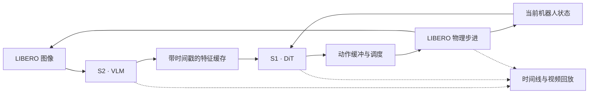

# piR2：从量化推理到实时机器人控制

**piR2 把 VLM/DiT 的量化、融合算子和执行调度接入真实 LIBERO 闭环，用同一条观测—推理—动作链路研究：模型变快之后，机器人能否更及时地使用新信息。**

项目从 [NVIDIA GR00T-N1.7-LIBERO 任务权重](https://huggingface.co/nvidia/GR00T-N1.7-LIBERO)出发，以 [NVIDIA LIBERO 示例](https://github.com/NVIDIA/Isaac-GR00T/blob/main/examples/LIBERO/README.md)建立常规 Flow 基线，再接入 [πR²](https://github.com/pi-r2-flow/pi-r2-flow) 适配、真实 VLM 闭环和系统优化。当前完整训练与评测流程覆盖 **Spatial 的全部 10 个任务**；Object、Goal、Long 的扩展目标记录在[模型清单](configs/libero/model-family.json)。

<a id="scope--范围"></a>

## 一条链路，三个实验层次

| 要回答的问题                   | 项目提供的能力                                                         | 主要证据                                                    |
| ------------------------------ | ---------------------------------------------------------------------- | ----------------------------------------------------------- |
| 量化与融合节省了多少推理时间？ | 固定真实输入的 BF16/W8A8/W4A4 模型回放、VLM/DiT 分段测量、算子 profile | 完整调用 wall 延时、GPU 活动、量化和打包占比                |
| VLM 和 DiT 怎样共享计算资源？  | 独立、并发、优先级和协作式调度；分进程或同进程双 worker                | 两个模型各自的响应时间、重叠与排队                          |
| 推理加速怎样影响机器人动作？   | 固定延迟算法对照、墙钟部署对照、同步/异步执行、πR² 滚动控制            | 任务成功率、deadline、已执行动作 AoI、fallback 与机器人视频 |

下面是缓存异步控制的依赖关系。S2 更新视觉特征，S1 结合当前状态生成动作，控制器在合法物理边界执行；回放保留每个动作的实际来源。



## 按任务阅读

| 任务                                            | 文档                                                                             |
| ----------------------------------------------- | -------------------------------------------------------------------------------- |
| 配置环境、准备任务权重、启动 Spatial 实验       | [环境](docs/environment.md) → [LIBERO 工作流](docs/libero.md)                    |
| 阅读量化、GEMM、融合与执行适配实现              | [算子与模块参考](coexecution/README.md)                                          |
| 测量模型延时、拆解开销或比较 VLM/DiT 争用       | [性能实验指南](docs/coexecution.md)                                              |
| 选择算法/部署协议、动作前缀、异步深度和接纳策略 | [时序协议](docs/timing-protocols.md)                                             |
| 在前端检查不同精度的模型时间线、动作来源和视频  | [前端使用](simulator/README.md) → [回放数据与接口](coexecution/replay/README.md) |
| 在 AGX Orin / AGX Thor 上复刻并接入流式播放平台 | [平台交接](docs/platform-handoff.md)                                             |
| 核对作者代码、第三方算子、固定版本和本地修改    | [源码关系](docs/upstream.md)                                                     |

测量分层对应不同结论：固定输入回放解释模型开销，闭环轨迹解释调度和动作时效，任务评测衡量控制质量。成功率与时序指标按 checkpoint、协议、初始条件和硬件配置配对报告；具体精度和平台的可用接口见[能力表](docs/platform-handoff.md#precision-support)。

## 移动目标研究

[LIBERO-Dynamic 接入](coexecution/libero_dynamic/README.md)已连接移动目标物理环境、默认 GR00T Flow4、BF16/W8A8 和已有 πR² 权重。默认 VLA 按逐请求实测耗时推进推理等待；πR² 用实测耗时驱动独立的 S1/S2 逻辑通道。前端按物理仿真时间回放动作、目标运动与请求来源，实际 CUDA 与物理计算串行。本阶段使用现成权重，不采用论文微调方法；套件覆盖与成功率由对应实验记录证明。

<a id="start--开始"></a>

## 开始使用

```bash
git clone --recurse-submodules https://github.com/Ther-nullptr/piR2.git
cd piR2
python3 tools/prepare_sources.py --component groot
```

随后按[环境指南](docs/environment.md)配置 CUDA 模型环境和独立的 LIBERO 仿真环境，再按 [LIBERO 工作流](docs/libero.md)准备权重、测量或评测。CUTLASS 可使用仓库记录的默认版本，也可通过 `CUTLASS_ROOT` 选择兼容安装，详见[依赖配置](docs/environment.md#cutlass-submodule)。

代码、必要配置和稳定使用说明进入版本管理；权重、数据、环境与实验产物留在本地。开发和提交检查见 [CONTRIBUTING.md](CONTRIBUTING.md)。

<a id="paper--论文"></a>

## 算法来源与辅助实验

πR² 算法来自 Sungjae Park 和 Shubham Tulsiani 的 _πR²: Reactive Real-time Flow Policies_（2026）：[论文](https://arxiv.org/abs/2607.26055) · [作者实现](https://github.com/pi-r2-flow/pi-r2-flow)。本仓库独立维护 LIBERO 适配、量化与调度实验、回放工具和可追踪补丁；作者代码与本地实现的边界见[源码关系](docs/upstream.md)。

[Leap 状态策略重建](simulation/README.md)、SO100 真实观测回放与浏览器队列教学工具提供辅助实验路径，各自保留独立的数据、协议和结果口径。
